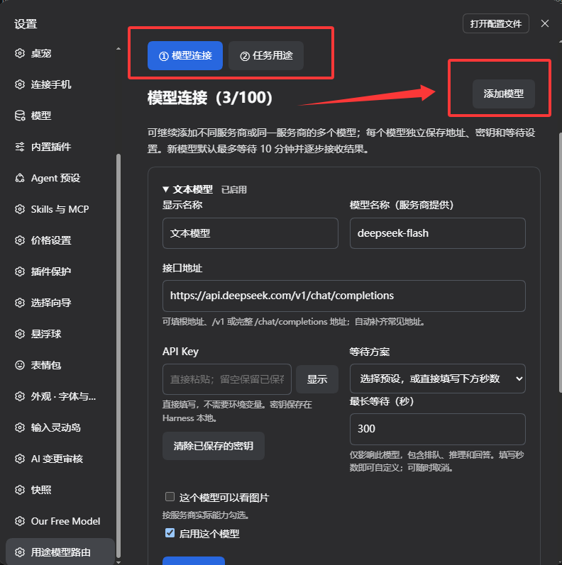
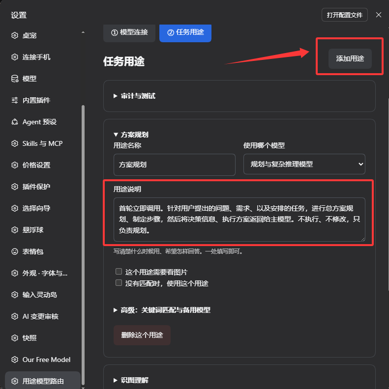
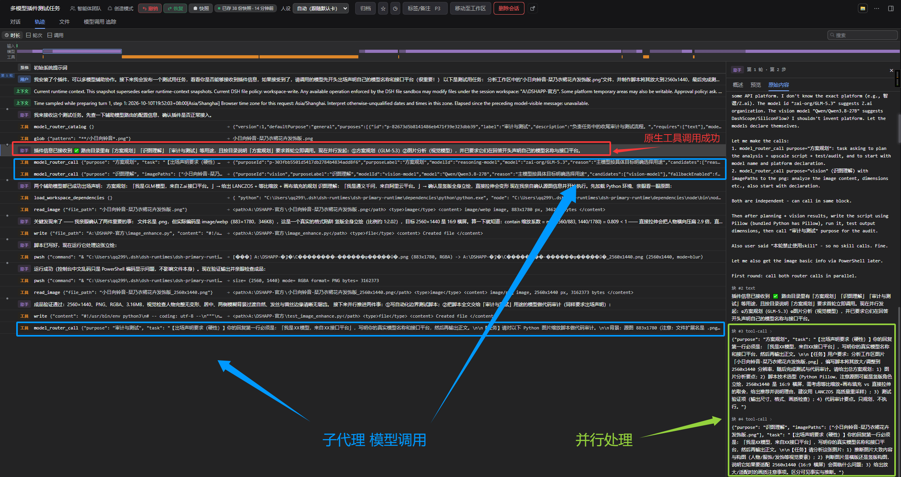

# 用途模型路由

**让擅长的模型做擅长的事。** 识图、规划、翻译、代码检查……在 DeepSeek Harness 桌面版里给每种用途选一个模型，主模型按任务调用，再把结果整理给你。

[下载安装包](https://github.com/Okazaki01/dsh-purpose-router/releases/latest) · [反馈问题](https://github.com/Okazaki01/dsh-purpose-router/issues) · [开发说明](docs/DEVELOPMENT.md)

- 用途可以直接写中文，模型地址、名称和 API Key 都在设置里填写。
- 支持多个服务商，也支持同一服务商的多个模型；最多 100 个模型、100 个用途。
- 每个模型独立设置等待时间，新增模型默认最多等 10 分钟。
- 保存后，下次辅助调用就使用新配置，不用反复重启。

这是社区插件，适用于 DeepSeek Harness 桌面版。已在官方 `0.2.0-rc.2` 组件环境验证；其他版本请先确认插件能正常启用。你需要准备自己的模型 API，初始模板不附带密钥，也不会自动发出请求。

## 安装：三种方式，选一种就行

### 1. 让 Agent 帮你安装

在 Harness **创造模式**中，把下面这段话发给 Agent：

```text
请安装 https://github.com/Okazaki01/dsh-purpose-router 的用途模型路由插件。
从最新 Release 获取 dsh-purpose-router 的 .tgz 安装包，优先使用
Harness 自带的 plugin_manager 安装到当前桌面配置并启用。
只安装这个插件，保留已有模型、密钥和其他插件配置。
完成后告诉我是否已启用、是否需要重启，以及在哪里配置用途和模型。
```

如果 Agent 当前没有插件管理工具，切到创造模式，或使用下面的桌面安装方式。按 Harness 提示完成安装授权即可，不需要把 API Key 发给 Agent。

### 2. 在 Harness 的“插件”页面安装（推荐）

1. 打开 [最新 Release](https://github.com/Okazaki01/dsh-purpose-router/releases/latest)，下载 **`dsh-purpose-router-版本号.tgz`**。
2. 打开 Harness 左侧 **插件 → 添加插件**。如果出现菜单，选择 **安装第三方插件**。
3. 在安装来源栏填入安装包的**完整路径**，例如 `C:\Downloads\dsh-purpose-router-0.1.0.tgz`。也可以直接粘贴 Release 中该 `.tgz` 文件的下载链接。
4. 点击 **安装**，完成后选择 **立即启用**；提示需要重启时再重启。

下载的是 Release 里的 `.tgz`，不是 GitHub 自动生成的 `Source code.zip`。安装包已经编译好，无需自己构建。

### 3. 手动安装

不经过 Agent 或插件页面，也可以用 **桌面软件自带的安装命令**完成。

先启动 Harness 一次，再完全退出。在软件安装目录找到 `resources/runtime/cli/bin/dsh.cmd`，用 PowerShell 执行：

```powershell
& "你的Harness安装目录\resources\runtime\cli\bin\dsh.cmd" plugin --profile desktop add "C:\Downloads\dsh-purpose-router-0.1.0.tgz"
```

把两处路径换成你电脑上的实际路径，然后重新打开 Harness。这里只借用桌面版自带命令安装同一个插件，使用和配置仍在桌面界面里；不要改用另装的 npm 版 `dsh` 去修改桌面配置，也不要只把文件复制进 `node_modules`。

安装步骤参考 Harness 官方的 [插件安装](https://github.com/deepseek-ai/deepseek-harness/blob/master/docs/user/develop/basic/publish.md)、[桌面插件页面](https://github.com/deepseek-ai/deepseek-harness/blob/master/packages/client/ui-plugin-manager/README.md)和 [桌面安装命令](https://github.com/deepseek-ai/deepseek-harness/blob/master/apps/desktop/README.md#bundled-command-runtime)。

## 配置：先加模型，再选用途

打开 **设置 → 用途模型路由 → 配置用途与模型**。

### 第一步：模型连接

点击 **添加模型**，填这几项：

| 填什么 | 怎么填 |
| --- | --- |
| 显示名称 | 你自己容易认出的名字，比如“我的识图模型” |
| 模型名称 | 服务商文档里给出的准确名称 |
| 接口地址 | 服务商的地址，支持根地址、`/v1` 或完整 `/chat/completions` 地址 |
| API Key | 直接粘贴，不需要配置环境变量 |
| 最长等待 | 普通任务可选 5 分钟，识图或复杂推理可选 10 分钟，也可以填写秒数 |

勾选 **启用这个模型**。支持图片的模型，再勾选 **这个模型可以看图片**。点击 **测试连接**，确认能返回文字后继续。



### 第二步：任务用途

点击 **添加用途**，写一个中文名字，选择 **使用哪个模型**，再写一段用途说明：**什么时候调用、希望它做什么**，放在同一处就够了。

例如：

> 用途名称：代码检查  
> 用途说明：实现完成后，检查提供的代码有没有明显错误和遗漏。先列问题，再给修改建议；不要声称已经运行测试。

识图用途勾选 **这个用途需要看图片**。最后点击 **保存并生效**。



最初的三个模型只是待填写模板，可以继续添加。多个用途也可以共用一个模型。内部 ID 自动生成，你不用填写。

## 开始使用

在正常会话里直接说明目标，比如：

```text
请按我的用途配置，先用“识图理解”分析这张截图，
再用“规划与推理”给出改进方案。告诉我实际调用了哪些模型。
```

主模型可以把不同目标分别交给辅助模型，再整合结果。独立任务是否并行，由主模型和 Harness 的调度决定。



图中的“子代理模型调用”指辅助模型请求；插件提供调用工具，不会另建一套能自行操作电脑的 Agent，也不会替换你当前的主模型。示例中的服务商和模型是演示配置，你可以换成自己的。

## 常见问题

**配置按钮是灰的？** 先到“插件”页面确认插件已启用、没有加载错误，再回设置点“重新读取配置”。仍不可用时，将插件版本、Harness 版本和错误截图发到 [Issues](https://github.com/Okazaki01/dsh-purpose-router/issues)，不要附 API Key。

**保存后密钥栏变空了？** 正常。重新打开设置不会回显已保存的 Key，留空保存会继续使用原来的 Key。要删除，点“清除已保存的密钥”再保存。密钥保存在 Harness 本地配置中。

**请求超时？** 先核对该模型的“最长等待”。插件默认逐步接收服务商返回的数据，等完整回答结束后再交给主模型；服务商或网络仍可能提前超时。插件不自动重试，避免反复产生费用。接口不兼容流式响应时，可在高级设置改为完整 JSON。

**能接哪些接口？** 当前支持 OpenAI 兼容 Chat Completions，以及 PNG、JPEG、GIF、WebP 图片。原生 Anthropic、Gemini、Responses 和图像生成接口暂不支持。文字连接测试通过，并不代表识图能力也已验证。

**更新怎么做？** 下载新的 `.tgz`，按“插件”页面提供的更新操作安装；如果当前版本只提供卸载重装，先备份自己的 Harness 配置再操作。不要把含密钥的配置上传到 GitHub。程序更新按应用提示重启，平时修改用途不需要重启。

模型调用和连接测试使用你自己的 API，可能计费。任务文字和选择的图片会发送到你配置的接口；备用模型默认关闭，主动添加备用后，失败转用可能带来另一笔调用费用。

## 给开发者

插件使用 Harness 原生工具、设置表单和认证连接。源码、可编辑桌面界面及预编译入口都在这个仓库，开发与测试方法见 [开发说明](docs/DEVELOPMENT.md)。

代码采用 [MIT License](LICENSE)。演示截图由项目作者提供，展示 DeepSeek Harness 界面；其中第三方产品标识的权利归各自所有者。本项目与 DeepSeek 官方无隶属关系。
